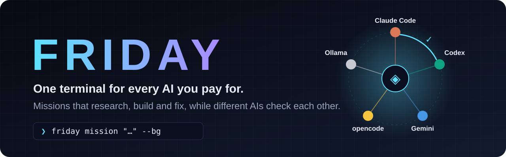

<p align="center">
  
</p>

<h1 align="center">FRIDAY ◈</h1>

<p align="center">
  <a href="docs/QUICKSTART.md">Quick start</a> ·
  <a href="docs/GUIDE.md">Full guide</a> ·
  <a href="docs/ARCHITECTURE.md">Architecture</a> ·
  <a href="docs/BENCHMARKS.md">Benchmarks</a>
</p>

<p align="center">
  
  
  
  
</p>

**FRIDAY is one terminal for every AI coding agent you already pay for.** It drives Claude
Code, Codex, Gemini CLI, opencode and Ollama from a single prompt. It keeps track of each
plan's usage limits and moves work to whichever agent still has room. For bigger jobs it
runs **missions**: it researches in parallel, writes a brief, builds on its own branch, and
then has a *different* AI review the work until it passes. A mission can run in the
background while it asks for your go on your phone.

<table>
<tr><td><b>Every AI you pay for</b></td><td>Claude Code, Codex, Gemini CLI, opencode and Ollama, behind one prompt. FRIDAY reads each plan's limits. When one agent nears its limit, the job moves to the one with the most room, so a Claude limit doesn't stop the work while your Codex plan sits unused.</td></tr>
<tr><td><b>AIs check each other</b></td><td>Codex reviews what Claude built, and the other way round. Every reviewer has to end with a verdict: <code>pass</code>, <code>fail</code> or <code>blocked</code>. Failures go back to the builder in its own session. If the same failure shows up twice, another agent takes the fix. A reviewer that couldn't open the files never counts as a pass.</td></tr>
<tr><td><b>Missions</b></td><td>"Build X, research it first." The research jobs run in parallel and read your code when the goal names a project. FRIDAY merges them into a brief, builds on a <code>friday/&lt;name&gt;</code> branch, then tests, reviews and fixes, and offers a pull request at the end. A question that only needs an answer ends with a checked brief.</td></tr>
<tr><td><b>Runs while you're away</b></td><td><code>friday mission "…" --bg</code> gives your terminal back. Questions wait for you in the terminal and on Telegram, with buttons to tap or a reply with what to change. An interruption, a crash or a usage limit pauses the mission instead of failing it, and <code>/mission resume</code> carries on.</td></tr>
<tr><td><b>A brain that routes</b></td><td>A cloud model (OpenRouter) or a local one (Ollama) decides what to do with each message. It answers small things itself and hands real work to the agent best at it: one agent, a build-then-review pipeline, or a council where every AI answers.</td></tr>
<tr><td><b>Your second brain</b></td><td>Optional: every agent works from your Obsidian vault. Edits go through one queue that pulls, commits and pushes. FRIDAY also remembers what you worked on across conversations.</td></tr>
<tr><td><b>Private stays private</b></td><td>Health-data words and the projects you seal never reach a cloud AI, and that's checked on every path: routing, missions, Telegram and pull requests. Private work goes to Ollama on your machine.</td></tr>
<tr><td><b>It changes itself</b></td><td>"From now on tell codex to be terse" changes a setting. "Add a panel to the HUD" sends an agent to edit FRIDAY on a branch, merged only if the tests pass. <code>/undo-self</code> reverts either.</td></tr>
<tr><td><b>Project HUD</b></td><td>A live radial map of the repo you're working in. Each agent is drawn as a satellite that fires a beam at every file it touches.</td></tr>
</table>

## Quick install

```sh
npm i -g friday-agents
friday setup
```

You need Node 20+ and at least one agent CLI (Claude Code, Codex, Gemini CLI or opencode)
installed and signed in. `friday setup` checks which ones you have, signs you in to the
missing ones, picks the brain (OpenRouter in the cloud, or Ollama on your machine), and
optionally connects your vault and Telegram. No npm dependencies.

## Getting started

```sh
friday                              # the cockpit, in this folder
friday setup                        # agents, sign-ins, the brain, your name, vault, Telegram
friday login                        # sign in to OpenRouter (the cloud brain)
friday telegram                     # connect a Telegram bot: missions ask you on your phone
friday mission "<goal>"             # lead a mission in the cockpit
friday mission "<goal>" --bg        # in the background; --yes approves plan and build itself
friday missions                     # background missions: running, waiting, done
friday mission log [n]              # a mission's output
friday mission answer <n> <reply>   # answer it: go, cancel, or what to change
friday hud                          # the project HUD in this terminal
```

## Terminal and phone

| Action | In the cockpit | On Telegram |
|---|---|---|
| Ask anything | type it; the brain routes it | |
| Start a mission | `/mission <goal>`, or just describe the job | |
| Approve the plan or the build | `go` | tap **go** |
| Change the plan | type what to change | reply with what to change |
| Pause or cancel | `pause` · `cancel` | tap **pause** · **cancel** |
| Pick it up again | `/mission resume` | |
| Background missions | `/missions` · `/mission log` · `/mission answer` | pings when they start and finish |
| Ask every AI at once | `/all <question>` | |
| Pick the brain | `/brain` | |

Type `/` in the cockpit to see every command; `/help` lists them all.

## Documentation

| | |
|---|---|
| [Quick start](docs/QUICKSTART.md) | Install, first run, the commands you'll actually use |
| [Full guide](docs/GUIDE.md) | Every feature in detail: routing, missions, the brain, the vault, self-changes, the HUD, config |
| [Architecture](docs/ARCHITECTURE.md) | What each module does and how they fit |
| [Benchmarks](docs/BENCHMARKS.md) | A FRIDAY mission against one Claude Code turn, judged by hidden acceptance checks |

## Contributing

```sh
git clone https://github.com/Ronak1Nambiar/friday && cd friday
npm test        # 184 tests, no agents or network needed
```

Plain Node, no build step and no dependencies. Issues and pull requests are welcome.

## License

[MIT](LICENSE)
